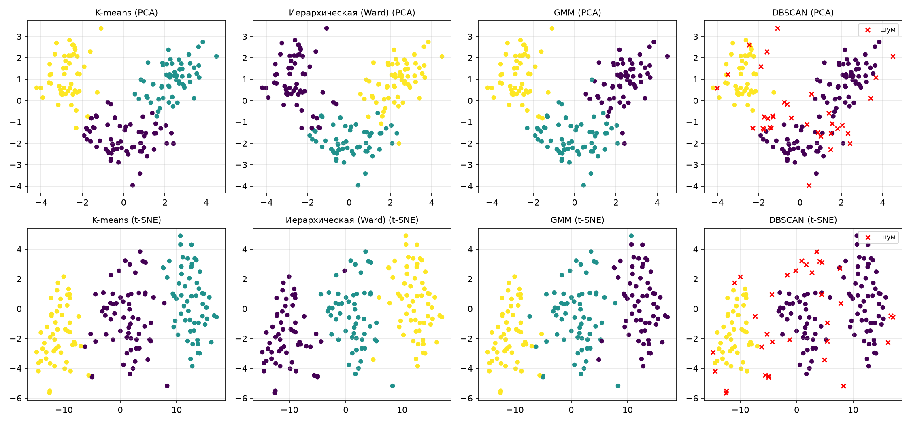

<div align="center">

# 🤖 Machine Learning Methods

**Laboratory projects · Semester 7**


Made by **Yahor Lashchenka** · group **351002** · BSUIR

</div>

---

## 📚 About

This repository contains the laboratory work for the *Machine Learning Methods* course.
Each lab lives in its own folder (`mmoN`) and includes the assignment, the code
(Jupyter notebook and/or Python script), generated figures and a written report in `.docx`.

## 🗂️ Labs

| # | Folder | Topic | Key tools |
|:-:|--------|-------|-----------|
| 1 | [`mmo1`](mmo1) | Python fundamentals: functions, exception handling, OOP (variant 17) | Python |
| 2 | [`mmo2`](mmo2) | Data preprocessing: cleaning, normalization, standardization | pandas, NumPy |
| 3 | [`mmo3`](mmo3) | Gradient descent: GD vs SGD, learning rate, L2 regularization | NumPy, matplotlib |
| 4 | [`mmo4`](mmo4) | Binary classification: logistic regression, SVM, CART | scikit-learn |
| 5 | [`mmo5`](mmo5) | Decision trees: Gini, information gain, stopping criteria | NumPy, scikit-learn |
| 6 | [`mmo6`](mmo6) | Ensembles: gradient boosting, `GridSearchCV`, learning rate vs. trees | scikit-learn, seaborn |
| 7 | [`mmo7`](mmo7) | Clustering: K-means, hierarchical, GMM, DBSCAN, PCA / t-SNE | scikit-learn, SciPy |

## ⭐ Latest: Lab 7 — Clustering

Unsupervised analysis of the **Wine** dataset (178 samples, 13 chemical features).
The true class labels are excluded from training and used only for external validation.

**Pipeline**

1. Load data without the target and check for missing values and duplicates
2. Remove multi-feature outliers (Tukey's IQR rule) and standardize features
3. Reduce dimensionality with PCA and t-SNE (for visualization)
4. Fit four clustering models and choose the number of clusters
   (elbow, silhouette, Davies–Bouldin, Calinski–Harabasz, dendrogram, BIC, k-distance plot)
5. Evaluate with internal and external metrics

**Results** (k = 3)

| Algorithm | Clusters | Noise, % | Silhouette | Davies–Bouldin | ARI | NMI |
|-----------|:--------:|:--------:|:----------:|:--------------:|:---:|:---:|
| **K-means** | 3 | 0.0 | 0.292 | 1.355 | **0.950** | **0.938** |
| GMM | 3 | 0.0 | 0.287 | 1.377 | 0.896 | 0.864 |
| Hierarchical (Ward) | 3 | 0.0 | 0.284 | 1.371 | 0.806 | 0.803 |
| DBSCAN (ε = 2.4, min_samples = 5) | 2 | 19.5 | 0.323* | 1.201* | 0.411 | 0.504 |

<sub>*Computed without noise points, so not directly comparable with the other rows.</sub>

K-means recovers the three grape cultivars almost perfectly (3 of 174 samples misassigned),
while DBSCAN struggles in the 13-dimensional space where density differences are small.

**Effect of dimensionality reduction** — every model is also trained on PCA- and t-SNE-transformed data (ARI):

| Algorithm | Original (13 features) | PCA, 8 components (90 % var.) | PCA, 2 components | t-SNE, 2 components |
|-----------|:----------------------:|:-----------------------------:|:-----------------:|:-------------------:|
| K-means | 0.950 | 0.950 | 0.928 | 0.835 |
| Hierarchical (Ward) | 0.806 | 0.865 | 0.930 | 0.804 |
| GMM | 0.896 | **0.966** | 0.946 | 0.835 |
| DBSCAN | 0.411 | 0.398 | 0.432 | 0.700 |

- Removing low-variance (noisy) directions helps Ward and GMM; the best result overall is GMM on 8 principal components.
- t-SNE inflates the silhouette score (~0.6) because it squeezes groups into compact islands, but it lowers ARI for K-means, Ward and GMM.
  DBSCAN is the only algorithm that benefits: it finds all three clusters in t-SNE space (ARI 0.700).

<p align="center">
  
</p>

## 🚀 Getting started

```bash
git clone https://github.com/sh4d0wwq/mmo.git
cd mmo

python -m venv .venv
# Windows: .venv\Scripts\activate   |   Linux/macOS: source .venv/bin/activate

pip install numpy pandas scipy scikit-learn matplotlib seaborn jupyter
```

Run a lab as a script or open its notebook:

```bash
python mmo7/lab7_clustering.py        # saves figures to mmo7/figures
jupyter notebook mmo7/lab7_clustering.ipynb
```

## 📁 Repository structure

```text
mmo/
├── mmo1/   # Python basics (notebooks, report)
├── mmo2/   # Data preprocessing
├── mmo3/   # Gradient descent
├── mmo4/   # Classification
├── mmo5/   # Decision trees
├── mmo6/   # Gradient boosting
├── mmo7/   # Clustering
│   ├── lab7_clustering.py
│   ├── lab7_clustering.ipynb
│   ├── results_summary.csv
│   ├── figures/
│   └── Отчет_ЛР7.docx
└── README.md
```

> Reports (`Отчет_ЛР*.docx`) are written in Russian according to the BSUIR STP 01-2017 standard.
